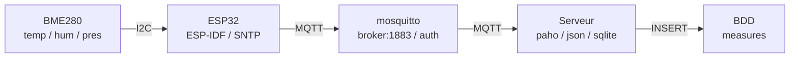
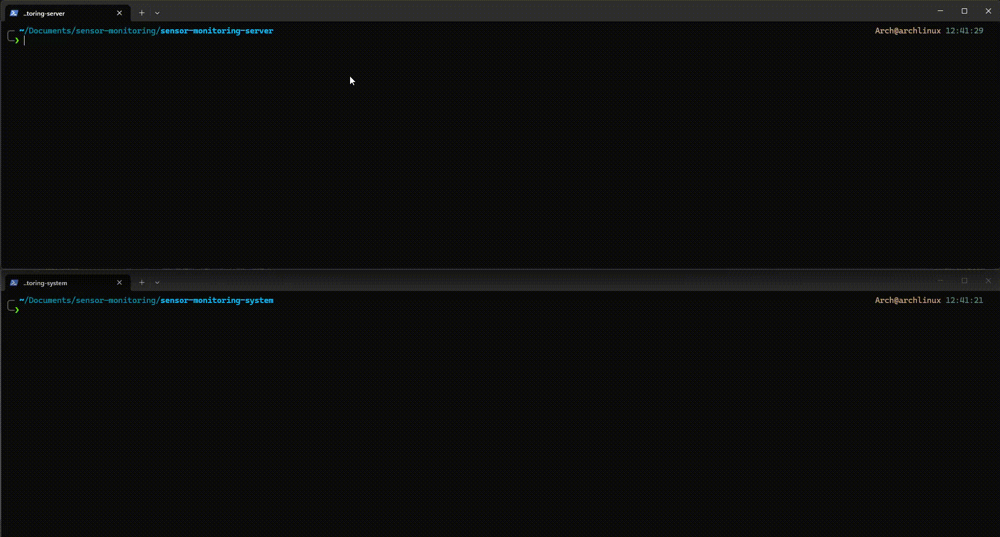

# Sensor Monitoring

Chaîne complète, du capteur jusqu'à la base de données : un ESP32 lit un BME280 et publie ses mesures en MQTT, un serveur les collecte et les archive dans SQLite.

Projet personnel, écrit en C des deux côtés (système embarqué 'ESP-IDF' et serveur 'Linux').

## Ce que fait le projet

- **Firmware** : lit température / humidité / pression toutes les 5 secondes, horodate chaque mesure à la source, et la publie en MQTT QoS1 sur un topic unique.
- **Broker** : mosquitto, authentifié, avec session persistante et persistance sur disque.
- **Serveur** : s'abonne au topic, valide et découpe le JSON, puis insère chaque mesure dans SQLite. Il conserve deux horodatages (capteur et réception) et refuse les doublons.
- **Rétention** : un script purge les mesures au-delà de 3 heures et récupère l'espace.

## Architecture


## Aperçu en fonctionnement



*Le firmware publie chaque mesure, le serveur la valide et l'archive, et la base
se remplit en direct.*

## Arborescence

```
sensor-monitoring/
 |- sensor-monitoring-system/      ESP32 (ESP-IDF)
 |  |- main/                          code source firmware
 |  |  |- sensor-monitoring-system.c     orchestration seule
 |  |  |- wifi.c/.h                      pile réseau, IP statique
 |  |  |- time_sync.c/.h                 SNTP et formatage d'horodatage
 |  |  |- sensor.c/.h                    bus I2C et BME280
 |  |  |- mqtt_pub.c/.h                  client MQTT et publication
 |  |  |- led.c/.h                       témoin lumineux
 |  |  |- info_config.h.example          configuration exemple
 |  |- make.sh                        build + flash + moniteur
 |- sensor-monitoring-server/      serveur (Linux)
 |  |- sensor-monitoring-server.c     signaux et orchestration     
 |  |- mqtt_sub.c/.h                  connexion, abonnement, reconnexion  
 |  |- measurement.c/.h               parsing JSON et horodatage          
 |  |- db.c/.h                        schéma et insertion                 
 |  |- log.c/.h                       logger à niveaux                    
 |  |- info_config.h.example          configuration exemple
 |  |- Makefile                       build + run + clean + distclean
 |- sensor-monitoring-database/    base de données + scripts de gestion
 |  |- clean_db.sh                    suppression selon la rétention            
 |  |- purge_db.sh                    suppression totale (make distclean)
 |- .gitignore                     configuration git
 |- demo.git                       gif de démonstration
 |- LICENSE                        licence MIT
 |- README.md                      documentation
```

## Matériel et câblage

| Élément | Broche |
|---|---|
| BME280 SDA | GPIO21 |
| BME280 SCL | GPIO22 |
| BME280 adresse | 0x76 |
| LED témoin | GPIO2 |

La carte se connecte en Wi-Fi avec une **adresse IP statique** (voir configuration) ; le DHCP est explicitement coupé pour que l'adresse du serveur de collecte soit prévisible.

## Format des messages envoyés

- **Topic** : `esp32/bme280/measurements` (topic exact, volontairement sans wildcard : le projet est mono-capteur).
- **Payload** :

```json
{"boot":1832046429,"seq":3247,"ts":"2026-10-15 18:14:28","temp":27.12,"hum":45.30,"pres":1004.56}
```

| Champ | Type | Rôle |
|---|---|---|
| `temp`, `hum`, `pres` | nombre | °C, %, hPa — **obligatoires** |
| `ts` | chaîne | horodatage de la mesure, UTC, `YYYY-MM-DD HH:MM:SS` |
| `boot` | entier | identifiant tiré au démarrage du capteur |
| `seq` | entier | compteur croissant depuis ce démarrage |

`boot` et `seq` forment la **clé d'idempotence**. `ts`, `boot` et `seq` sont optionnels : un payload qui ne les contient pas est accepté, mais le serveur ne peut alors ni dater la mesure à la source, ni filtrer les doublons.

Le format d'horodatage est identique à celui de `datetime('now')` de SQLite, ce qui rend les comparaisons et la purge directes.

## Base de données

```sql
CREATE TABLE measures (
    id           INTEGER PRIMARY KEY AUTOINCREMENT,
    measured_at  TEXT,             -- horodatage capteur (NULL si horloge non synchronisée)
    received_at  TEXT NOT NULL,    -- horodatage de réception par le serveur
    boot_id      INTEGER,          -- clé d'idempotence, NULL si le payload ne la fournit pas
    seq          INTEGER,
    temperature  REAL,
    humidite     REAL,
    pression     REAL
);

CREATE INDEX idx_measures_received_at ON measures(received_at);
CREATE UNIQUE INDEX idx_measures_boot_seq ON measures(boot_id, seq);
```

Réglages appliqués à l'ouverture : `journal_mode=WAL`, `synchronous=NORMAL`, `temp_store=MEMORY`, `busy_timeout=5000`, `auto_vacuum=INCREMENTAL`.

**Pourquoi deux horodatages.** Une mesure peut attendre dans une file (coupure réseau, serveur arrêté) avant d'arriver. `received_at` dit quand le serveur l'a reçue, `measured_at` quand le capteur l'a prise. Sans le second, un lot livré d'un coup porterait une seule et même heure et l'historique serait écrasé, c'est notamment un cas plus ou moins récurrent avec la politique de QoS 1.

**Pourquoi une clé d'idempotence.** MQTT en QoS1 garantit « au moins une fois » : si l'acquittement se perd, le broker renvoie le même message. Avec `INSERT OR IGNORE` et l'index unique, la seconde livraison est ignorée au lieu de créer une ligne de plus.

## Prérequis

| Côté | Ce qu'il faut |
|---|---|
| Firmware | **ESP-IDF v6.1** (les commandes du README s'appuient sur ce chemin), `idf.py`, la chaîne de compilation croisée installée par `install.sh` d'ESP-IDF |
| Serveur | `gcc`, `make`, et les paquets `sqlite3`, `json-c`, `paho-mqtt-c` |
| Broker | `mosquitto` |
| Système | Linux — le serveur résout le chemin de sa base via `/proc/self/exe` |
| Matériel | un ESP32 et un BME280 câblés en I2C |

Le serveur est lié à `libpaho-mqtt3c` (le client MQTT **synchrone** de paho) :
c'est cette variante qui doit être installée.

## Configuration

Toute la configuration locale vit dans un `info_config.h` **non versionné** :

```bash
cp sensor-monitoring-system/main/info_config.h.example sensor-monitoring-system/main/info_config.h
cp sensor-monitoring-server/info_config.h.example    sensor-monitoring-server/info_config.h
```

Renommer les fichiers examples avec les deux commandes ci-dessus, puis renseigner les valeurs. Attention, c'est du compile-time : modifier une valeur impose de recompiler.

| Firmware | Serveur |
|---|---|
| `ESP_WIFI_SSID`, `ESP_WIFI_PASS` | `MQTT_BROKER` |
| `ESP_STATIC_IP`, `ESP_STATIC_GW`, `ESP_STATIC_NETMASK` | `MQTT_USERNAME`, `MQTT_PASS` |
| `MQTT_BROKER`, `MQTT_USERNAME`, `MQTT_PASS` | `MQTT_TOPIC_MEASUREMENTS` |
| `MQTT_TOPIC_MEASUREMENTS` | `MQTT_CLIENT_ID` |
| `ESP_SNTP_SERVER` | `DB_PATH`, `LEVEL_LOG` |

`DB_PATH` est interprété **relativement au répertoire du binaire** (résolu au démarrage via `/proc/self/exe`) : le serveur fonctionne donc quel que soit le répertoire d'où on le lance, sans chemin absolu en dur.

## Mise en route

### 1. Broker MQTT

```bash
sudo pacman -S mosquitto
sudo mosquitto_passwd -c /etc/mosquitto/passwd esp32
```

Dans `/etc/mosquitto/mosquitto.conf` :

```
listener 1883 0.0.0.0
allow_anonymous false
password_file /etc/mosquitto/passwd

persistence true
persistence_location /var/lib/mosquitto/
max_queued_messages 5000
```

```bash
sudo install -d -o mosquitto -g mosquitto -m 0750 /var/lib/mosquitto
sudo systemctl restart mosquitto
```

### 2. Serveur

```bash
cd sensor-monitoring-server
make          # compile
make run      # compile et lance
```

Dépendances : `sqlite3`, `json-c`, `paho-mqtt-c`.

La base est créée automatiquement au premier démarrage, avec son schéma et ses index. `Ctrl-C` provoque un arrêt propre (déconnexion MQTT et fermeture de la base).

### 3. Firmware

```bash
cd sensor-monitoring-system
. ~/.espressif/v6.1/esp-idf/export.sh
idf.py build
idf.py -p /dev/ttyUSB0 flash monitor     # adapter le port
```

`make.sh` enchaîne les trois. Le port série dépend de la carte : le vérifier avec `ls /dev/ttyUSB* /dev/ttyACM*` et modifier si nécessaire.

## Exploitation

Quelques requêtes utiles :

```bash
# état général
sqlite3 sensor-monitoring-database/db_esp32.db \
  "SELECT COUNT(*), MIN(received_at), MAX(received_at) FROM measures;"

# écart entre heure capteur et heure de réception (détecte les rattrapages)
sqlite3 sensor-monitoring-database/db_esp32.db \
  "SELECT received_at, COUNT(*) FROM measures GROUP BY received_at ORDER BY COUNT(*) DESC LIMIT 5;"

# trous dans la numérotation (= mesures perdues)
sqlite3 sensor-monitoring-database/db_esp32.db \
  "SELECT boot_id, COUNT(*), MAX(seq)-MIN(seq)+1 FROM measures GROUP BY boot_id;"
```

Sur la dernière requête : si le nombre de lignes égale la plage des `seq`, rien n'a été perdu sur la période. En exploitation, cette égalité a été vérifiée sur 1463 mesures consécutives (aucun trou), et le redémarrage du serveur a permis de récupérer 1173 mesures mises en file entre-temps grâce à la politique QoS 1.

### Rétention

```bash
bash sensor-monitoring-database/clean_db.sh
```

Supprime par paquets de 2000 les mesures dont `received_at` dépasse 3 heures, puis applique un `incremental_vacuum`. Le script est idempotent et sans effet sur une base à jour. Il n'est **pas planifié** : à lancer périodiquement, par exemple via un timer systemd :

```ini
# /etc/systemd/system/clean-db.timer  ->  OnCalendar=hourly
```

`make distclean` supprime les objets, le binaire, la base et son log.

## Logs

Le serveur dispose d'un logger à trois niveaux. Chaque ligne porte un niveau, un
temps écoulé, un topic et le message :

```
I (1234) DB: Base de données prête !
W (5678) DB: Doublon ignoré (même boot/seq)
E (9012) MQTT: Connexion MQTT perdue : raison inconnue
```

- Le nombre entre parenthèses est un **temps écoulé en millisecondes depuis le démarrage**.
- `I` (information) part sur `stdout`, `W` (avertissement) et `E` (erreur) sur `stderr` : rediriger les deux flux séparément permet d'isoler les problèmes.
- `LEVEL_LOG` (dans `info_config.h`) filtre les niveaux `I` et `W`. Les erreurs, elles, s'affichent **toujours** — y compris si la verbosité est au minimum.
- Les topics correspondent aux modules : `APP`, `DB`, `MQTT`, `JSON`.

## Choix de conception

**Aucune donnée perdue, en trois maillons.** Chacun a été traité séparément :

1. *Émetteur* — le firmware publie **même hors ligne**. Le composant MQTT conserve alors le message dans son outbox et le renvoie à la reconnexion.
2. *Broker* — session persistante et persistance sur disque : les mesures publiées pendant que le serveur est arrêté sont livrées à sa reconnexion.
3. *Récepteur* — la reconnexion est explicitement gérée : sans elle, le serveur resterait déconnecté indéfiniment après une coupure réseau. Le réabonnement n'est pas nécessaire, la session persistante le garantit.

Le compteur `seq` rend la promesse **vérifiable** : un trou dans la numérotation signale une perte réelle, au lieu de la masquer.

## Limites connues

- **Mono-capteur.** Ni colonne `device`, ni wildcard dans l'abonnement. Passer à plusieurs capteurs demanderait d'ajouter la source à la clé d'idempotence ainsi qu'un abonnement MQTT wildcard.
- **Pas de chiffrement.** MQTT circule en clair et les identifiants sont visibles sur le réseau local. Un **mot de passe long et unique** est indispensable. La migration vers TLS (`mqtts://`, port 8883, certificat serveur) est le premier axe d'amélioration.
- **Pas de DNS sur le capteur.** Le firmware utilise une IP statique et arrête le DHCP, mais ne configure aucun serveur DNS. Toutes les adresses doivent donc être des IP littérales.
- **La perte reste bornée.** L'outbox du firmware est en RAM (un redémarrage du capteur perd ce qu'elle contenait) et la file du broker est limitée à 5000 messages, soit environ 7 heures à cette cadence.
- **Reconnexion bornée.** Après 5 tentatives espacées de 10 s, le serveur abandonne et le signale. Un superviseur est la réponse adaptée.
- **Résolution du chemin Linux uniquement** : `/proc/self/exe` n'existe pas ailleurs.

## Pistes d'amélioration

- TLS et authentification mutuelle entre le capteur et le broker.
- Superviseur systemd pour le serveur, timer pour la rétention.
- Colonne `device` et abonnement par wildcard pour plusieurs capteurs.
- Passage de la configuration du firmware à Kconfig (`idf.py menuconfig`), plus idiomatique que le header local.
- Tests unitaires des composants purs (ring buffer, parsing) sur PC, hors cible.

## Licence

MIT — voir [LICENSE](LICENSE).
